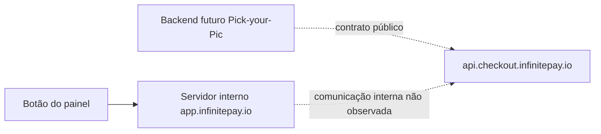

# Pesquisa técnica complementar — InfinitePay

Data: 12/10/2026. Escopo: Etapa A do relatório enviado pelo proprietário, comparação com a implementação local e identificação dos requisitos para Etapas B–D. Não houve alteração de código de aplicação, instalação/execução dos exemplos comunitários, teste financeiro ou habilitação de conta nesta pesquisa.

## 1. Resultado e decisão de autenticação

Existe documentação oficial para criação de links e consulta de pagamento do Checkout Integrado. A página oficial de apresentação contém inclusive um exemplo cURL com apenas `Content-Type: application/json`, `handle` e dados do pedido. O plugin comunitário examinado também não acrescenta autenticação nas chamadas. Esses fatos sustentam pesquisar um fluxo público distinto da sessão do painel, mas não esclarecem quando a API Key disponibilizada na conta é exigida.

**Estado no momento desta pesquisa inicial:** nenhum mecanismo externo havia sido implementado. A decisão posterior do proprietário autorizou usar o fluxo público sem chave para `/links` e `/payment_check`, sem inferir `Authorization: Bearer <API Key>`. A observação de Bearer no painel não autoriza usar tokens de sessão no SaaS. `handle` identifica a conta recebedora e não é prova remota de autorização/titularidade.

Atualização documental de 12/10/2026: o primeiro texto avulso colado pelo titular não tem fonte confiável e foi excluído como evidência. O segundo texto foi conferido com o artigo oficial da Central de Ajuda: [Como usar o Checkout Integrado](https://ajuda.infinitepay.io/pt-BR/articles/10766888-como-usar-o-checkout-integrado-da-infinitepay). Ele repete os endpoints atuais `/links` e `/payment_check`, schema, webhook e resposta de checkout. Esse artigo diz “consulte a documentação para configurar as credenciais” mas não informa header, formato nem escopo da API Key; portanto ele torna a dúvida da chave mais concreta, sem resolvê-la. O exemplo de `url` do artigo usa `checkout.infinitepay.com.br`; a chamada de teste autorizada anteriormente desta conta retornou `checkout.infinitepay.io`. O cliente local agora allowlista somente esses dois hosts exatos por evidência oficial/teste. A documentação oficial do endpoint `/links` mostra `Content-Type: application/json` e nenhum header de API Key. A divergência entre a instrução de credenciais e os exemplos de requisição continua pendente de esclarecimento.

O endpoint oficial de criação e o teste de rede sem credenciais já registrado dão base suficiente para implementar o cliente `/links` sem API Key explícita. Isso não resolve a contradição com a tela API/Keys, que descreve chaves como autenticação do Checkout Integrado; também não comprova autenticação de `/payment_check` nem formato/escopo dessas chaves. Não pedir nem persistir uma chave até existir contrato que indique como e onde ela é usada. A implementação deve permitir manter o cliente real inativo enquanto essa contradição operacional for verificada.

Permanecem bloqueados o contrato real de autenticação e a conclusão do onboarding de vendedores independentes. Isso não significa inviabilidade do produto: falta comprovar a autorização por conta e como as chaves participam dela. O cliente HTTP baseado nos exemplos públicos foi implementado somente como componente local e mockado; ele não está registrado como operacional, não foi chamado contra o serviço durante esta continuação e não habilita nenhum fotógrafo.

## 2. Fontes oficiais

| Fonte exata | Evidência | Limite |
|---|---|---|
| https://www.infinitepay.io/checkout-documentacao | `/links`, `/payment_check`, handle, itens, valores em centavos, retorno e webhook | Não apresenta formato de API Key, assinatura, contrato de idempotência ou autorização delegada |
| https://ajuda.infinitepay.io/pt-BR/articles/10766888-como-usar-o-checkout-integrado-da-infinitepay | Habilitação pelo titular; endpoints/schema; diz para consultar documentação e configurar credenciais; resposta mostra `checkout.infinitepay.com.br` | Não especifica header/formato, escopo/rotação da chave, assinatura nem associação chave/recebedor |
| https://app.infinitepay.io/external-checkout#documentacao | Documentação dentro da conta, correspondente ao anexo do titular | Botão de teste usa backend interno do painel; não prova a autenticação do endpoint público |
| https://app.infinitepay.io/external-checkout#configuracoes | API Keys descritas como autenticação do Checkout Integrado; seletores Cartão/Pix | Não documenta header, permissões ou assinatura. Nenhuma configuração foi alterada |
| https://www.infinitepay.io/checkout | Exemplo oficial completo de `POST /links`, com header de JSON e corpo por handle, sem credencial mostrada | Exemplo publicado não prova que todas as contas/canais possam dispensar chave |
| https://www.infinitepay.io/desenvolvedores | Integração com sistemas de terceiros e canal técnico `parcerias@cloudwalk.io` | Não especifica um protocolo de autorização de múltiplos vendedores |
| https://www.infinitepay.io/blog/integracao-infinitepay | Distingue Checkout Integrado de Link de Pagamento e orienta conferir status antes da entrega | Texto sobre credenciais e estados não fornece schema detalhado de autenticação/negativas |

A FAQ de https://www.infinitepay.io/checkout-tap afirma dispensa de API Key para **InfiniteTap**. Isso se refere ao produto de aproximação presencial e não foi transferido para o Checkout Integrado.

## 3. Repositórios comunitários — versões fixadas

### WooCommerce

Repositório: https://github.com/leofelipet/infinitepay-for-woocommerce. Versão declarada **1.0.1**, branch `main`, commit **ebd47da75efe5707ff53d209775c45b3bca43427**, data do commit **20/08/2026**. Metadata e árvore consultadas via API GitHub; arquivos lidos pelo SHA, não por branch mutável. Não instalado nem executado.

Arquivos e evidências reproduzíveis:

- [Cliente HTTP](https://github.com/leofelipet/infinitepay-for-woocommerce/blob/ebd47da75efe5707ff53d209775c45b3bca43427/includes/class-infinitepay-api.php): base `https://api.checkout.infinitepay.io`; `create_link()` chama `/links`; `payment_check()` chama `/payment_check`; `request()` define somente `Content-Type: application/json` e `Accept: application/json`, timeout de 30 s e JSON. O código do plugin não acrescenta API Key, Bearer ou assinatura. Isso descreve sua configuração explícita; hooks globais de uma instalação WordPress externa não foram inspecionados.
- [Montagem e confirmação do pedido](https://github.com/leofelipet/infinitepay-for-woocommerce/blob/ebd47da75efe5707ff53d209775c45b3bca43427/includes/class-infinitepay-order.php): cria `order_nsu`, `items`, redirect/webhook; inclui dados de comprador/endereço quando existentes. Consulta usando handle, order_nsu, transaction_nsu e slug. `confirm_payment()` compara o NSU ao pedido, requer transaction/slug e retorna sem confirmar se houver erro de transporte ou `paid` vazio. Quando aceita, chama `payment_complete()` e grava metadados.
- [Webhook e retorno](https://github.com/leofelipet/infinitepay-for-woocommerce/blob/ebd47da75efe5707ff53d209775c45b3bca43427/includes/class-infinitepay-webhook.php): JSON recebido resolve pedido e dispara consulta; retorno do comprador também pode dispará-la. Não implementa verificação de assinatura. O retorno do browser não confirma sozinho.
- [Configuração e criação](https://github.com/leofelipet/infinitepay-for-woocommerce/blob/ebd47da75efe5707ff53d209775c45b3bca43427/includes/class-infinitepay-gateway.php): um handle nas opções da loja, habilitação, título, descrição e debug; sem campo API Key. Cria link, guarda URL/slug, deixa pedido pendente e redireciona. Não modela fotógrafos independentes dentro do mesmo SaaS.

Limitações observadas no código, relevantes para não copiar o fluxo integralmente:

1. A confirmação aceita `paid` não vazio sem conferir `success`, valor-base esperado ou exigir `credit_card`. Não é suficiente para o contrato financeiro do Pick-your-Pic.
2. O webhook retorna HTTP 200 após chamar confirmação mesmo quando ela retorna `false`; não há recibo durável/retentativa de worker nesse caminho. Uma falha transitória pode perder uma oportunidade de confirmação.
3. A criação tenta novamente com `itens` no lugar de `items` quando recebe `WP_Error`, inclusive após falha de rede. Sem contrato de idempotência, timeout após aceitação pode gerar outra cobrança. A inconsistência textual items/itens da documentação não justifica esse retry no produto.
4. A flag de confirmação evita repetição sequencial, mas o trecho não oferece lock transacional, exclusividade global da transação ou proteção completa contra concorrência/replay entre contas.
5. Webhook usa o handle atualmente configurado na loja; não congela a identidade antiga do recebedor por compra. Debug registra payload/resposta, incluindo dados opcionais. Nosso desenho exige snapshot e minimização.

### PHP

Repositório: https://github.com/SkylineNando/InfinitePay. Branch `main`, commit **da221a7f3ffde66a86589747ee9473f8292232e0**, data do commit **06/03/2024**. Sem versão de aplicação declarada nos arquivos examinados. Arquivos do exemplo e README lidos pelo SHA; não executados.

- [processar_pagamento.php](https://github.com/SkylineNando/InfinitePay/blob/da221a7f3ffde66a86589747ee9473f8292232e0/Link%20de%20pagamento/processar_pagamento.php) recebe estabelecimento/valor do formulário e concatena `https://pay.infinitepay.io/<estabelecimento>/<valor>/`.
- [script.js](https://github.com/SkylineNando/InfinitePay/blob/da221a7f3ffde66a86589747ee9473f8292232e0/Link%20de%20pagamento/script.js) envia formulário ao próprio PHP com `application/x-www-form-urlencoded` e redireciona para o texto retornado.
- Não há requisição HTTP do PHP à InfinitePay, header de autenticação externa, `/links`, `/payment_check`, webhook, persistência/idempotência ou isolamento de vendedores. O servidor não calcula o valor a partir de pedido autorizado; há comentário sugerindo validação, sem implementação correspondente. Método diferente de POST retorna 405, mas não há tratamento de erro de provedor porque o provedor nem é consultado.

Esse exemplo descreve montagem de Link de Pagamento, não uma implementação verificável do contrato atual de Checkout Integrado. Não será usado como base de autenticação ou confirmação automática.

## 4. Teste do painel já autorizado e realizado

Em uma execução anterior, explicitamente solicitada pelo proprietário, foi observado um clique em Testar API. Ambas as chamadas retornaram HTTP 200:

| Chamada observada | Headers relevantes | Corpo observado, sem valores de conta/segredos |
|---|---|---|
| `POST https://app.infinitepay.io/api/session/write-token` | Authorization, Cookie, Content-Type JSON | scopes |
| `POST https://app.infinitepay.io/api/checkout/links` | Authorization com esquema Bearer, Cookie, Content-Type JSON, X-Correlation-Id, X-Source, X-Visitor-Hash | handle, items e order_nsu acrescentado pelo painel |

Não foi possível recuperar o corpo das respostas via CDP. Não foi comprovado que o Bearer da segunda chamada veio da primeira, nem que corresponde à API Key criada na conta. Não houve replay manual de credenciais nem chamada direta ao endpoint público nessa execução. O link anteriormente compartilhado pelo titular e a observação HTTP são evidências distintas. A captura exportada contém somente nomes dos headers e valores não secretos; tokens/cookies não foram exportados.

## 5. Endpoints e arquitetura previstos; estado real

### Ensaio direto do endpoint público — 12/10/2026

Às 18:54:03 BRT, uma única chamada autorizada a `POST https://api.checkout.infinitepay.io/links`, com cliente HTTP novo, TLS validado, sem cookies, Authorization, API Key, proxy de ambiente, redirects ou retries, retornou **HTTP 200** e JSON com `url`. Enviados `handle` do titular, um item de exemplo de 1.000 centavos e `order_nsu` UUID exclusivo. Header de aplicação: `Content-Type: application/json`; demais headers automáticos de transporte não continham credenciais.

A URL retornada usa `https://checkout.infinitepay.io/<handle>?lenc=...`, em vez do caminho curto anteriormente mostrado pelo painel. O conteúdo integral, UUID e URL reais foram preservados somente fora do Git. Nenhum pagamento foi realizado. Não repetir a emissão para testar parser: reutilizar fixture sanitizada deste formato.

**Conclusão limitada:** criação pública sem autenticação explícita funciona para essa conta nas condições observadas e coincide com o cURL oficial. Isso não prova titularidade, autorização delegada, assinatura, semântica de `payment_check`, ausência de PIX nem efeitos das API Keys. A finalidade/obrigatoriedade da chave em outros endpoints/perfis continua sendo pergunta objetiva ao provedor; não criar campo de chave por hipótese.

| Componente | Contrato previsto | Estado no Pick-your-Pic |
|---|---|---|
| Configuração da conta | tenant, administrador, handle, versão, estado e metadados mínimos | Modelo e migration 0075 implementados localmente; APIs/tela ainda pendentes |
| Segredo individual, se exigido | referência por tenant a armazenamento seguro no servidor; valor nunca em leitura pública/log/checkout | Ainda não projetado em detalhe nem implementado; depende do contrato e reconciliação da configuração autônoma com o roadmap |
| Preparação da compra | preços autoritativos, UUID, snapshot de recebedor/itens/valor, reserva e tentativa durável | Planejado, não implementado |
| Cliente HTTP | `POST /links`, JSON handle/items/order_nsu/redirect_url/webhook_url; exemplo público não mostra autenticação | Inicialmente implementado em `backend/app/payment_provider.py` inativo. Decisão posterior do proprietário: prosseguir para ensaio sem API Key, conforme exemplo público e POST `/links` já observado retornar URL sem credencial. A finalidade da chave da UI permanece sem especificação para os endpoints usados. |
| Consulta de status | `POST /payment_check`, JSON handle/order_nsu/transaction_nsu/slug; resposta documenta success/paid/amount/paid_amount/capture_method | Cliente e normalizador implementados localmente; confirmação segue isolada no serviço financeiro e não tem chamador HTTP/worker. Vinculação/semântica de taxas ainda não ensaiadas |
| Recepção de eventos | autenticação oficial, persistência antes do ACK, deduplicação e processamento por worker | Não implementada; contrato de assinatura ou alternativa oficial ainda pendente |
| Decisão financeira | atualização atômica dos pedidos, transação única, hold de correção, entrega e aviso lógico único | Planejada, não implementada |
| Interface cliente | PIX manual próprio ou cartão disponível para a conta | Cartão ainda não implementado; PIX existente preservado |

O dinheiro deve seguir diretamente para a conta de cada fotógrafo, sem split, carteira intermediária, comissão ou cobrança de assinatura do SaaS nesta change. A conta/recebedor vêm do pedido e da configuração autorizada no servidor, nunca livremente do browser. PAN/CVV permanecem no provedor. O handle não será usado como prova de consentimento.

O relatório recebido permite estudar assinatura, quando oferecida, ou verificação oficial disponível. Ainda não existe um contrato concreto comprovado que permita selecionar essa alternativa. Nenhum header/algoritmo foi inventado; o requisito atual de assinatura no roadmap não foi removido e precisa ser reconciliado com a solução efetivamente comprovada antes do código afetado.

## 6. Matriz das questões de autenticação e múltiplos vendedores

| Questão | Conclusão verificável |
|---|---|
| Como o painel autentica o teste? | Authorization/Cookie na chamada interna; Bearer na criação. Valores secretos preservados |
| O painel envia automaticamente a API Key? | Não demonstrado; não confundir Bearer com a chave cadastrada |
| A API Key é obrigatória em links/payment_check? | Criação pública sem chave retornou 200 e URL no ensaio direto; `payment_check` e finalidade das chaves do painel ainda não confirmados |
| Qual header, formato e escopo? | Sem contrato confirmado; não adotar Bearer/X-API-Key por tentativa |
| Cada fotógrafo gera sua chave? A que entidade fica vinculada? | Sem especificação suficiente; não assumir chave global nem associação apenas pelo handle |
| Revogação, rotação, permissões e ambiente? | A UI oferece criação/exclusão, mas não documenta efeitos, escopos ou sandbox |
| SaaS com vários vendedores é oficialmente previsto? | Página de desenvolvedores admite integração em sistemas; ajuda menciona marketplaces. Há indício oficial favorável, mas não protocolo de autorização individual nem garantias de isolamento externo descritos |
| Titularidade do recebedor e vínculo do pagamento? | Identificação por handle documentada; prova de titularidade e rejeição de combinações estrangeiras ainda não comprovadas |

A viabilidade técnica é plausível; a autorização e o contrato operacional permanecem pendentes. Não há evidência de proibição que justifique trocar de produto ou centralizar recebíveis. Também não há evidência suficiente para declarar autorização delegada validada.

## 7. Validações e limites

- Nesta pesquisa: inspeção estática por commit de sete arquivos do WooCommerce e quatro arquivos do exemplo PHP; releitura das fontes oficiais; comparação com modelos/migration/tasks locais e com a evidência sanitizada de rede. Sem execução de software comunitário.
- Evidência local anterior reutilizada: cinco testes de persistência e três de migration PostgreSQL aprovados, conforme `implementation.md`. Nenhum código afetado foi alterado nesta pesquisa. Esses oito testes não validam HTTP, pagamento ou webhook.
- Ainda não executados: emissão externa pelo backend Pick-your-Pic (o teste atual usa MockTransport), aprovação/recusa real, confirmação HTTP real, contrato de assinatura/replay, idempotência após timeout ou dois vendedores no provedor. Não confundir teste sintético com teste completo do SaaS.
- Nenhuma chave real foi recebida, configurada ou gravada em relatórios/Git. Nenhum deploy foi realizado. O resultado da validação documental deste incremento deve constar em `implementation.md` após sua execução.

## 8. Próximo desbloqueio e entregáveis

O canal técnico publicado pela própria InfinitePay é **parcerias@cloudwalk.io**, além do suporte pelo app. A solicitação atualizada está em `support-request.md`, pronta para encaminhamento à equipe de integrações. A existência de uma mensagem preparada não equivale a envio ou resposta oficial.

Recomendação original antes da decisão posterior do proprietário: esclarecer a chave, autenticação de webhook, crédito exclusivo e recuperação antes de conectar rotas. A decisão posterior autorizou a configuração local por InfiniteTag e o fluxo de retorno com `/payment_check` sem API Key, sem inventar um header. Isso não resolve webhook assinado nem retorno perdido. O código foi então ligado à compra, mantendo explícitos os limites e deixando a validação operacional pendente; não declarar homologação ou recebimento pronto com base em evidência sintética.
